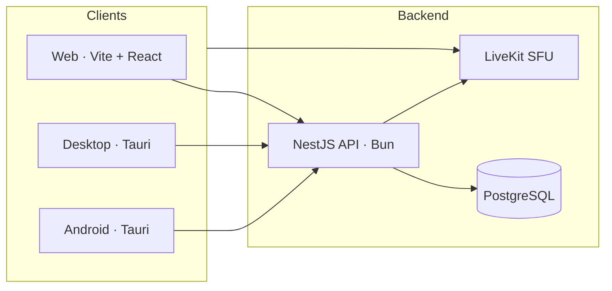

<p align="center">
  
</p>

<h1 align="center">Chatovo</h1>

<p align="center">
  <strong>Real-time voice rooms for web, desktop & Android.</strong><br/>
  One React app · Tauri native shells · LiveKit media · Self-hostable
</p>

<p align="center">
  <a href="https://chatovo.ru"></a>
  <a href="./LICENSE"></a>
  
  
</p>

<p align="center">
  <a href="https://chatovo.ru">Open Chatovo</a>
  &nbsp;·&nbsp;
  <a href="../../issues">Report a bug</a>
  &nbsp;·&nbsp;
  <a href="../../issues">Request a feature</a>
</p>

<br/>

## What is Chatovo?

Chatovo is a **Discord-inspired voice messenger** built around rooms — not endless channel lists. Spin up a room, share the link, start talking. Public, private, or password-protected.

<table>
<tr>
<td width="33%" valign="top">

**Rooms first**

Each room is its own space. No noisy server hierarchies — just the people you invited.

</td>
<td width="33%" valign="top">

**One UI everywhere**

The same experience in the browser, on Windows/macOS/Linux, and on Android.

</td>
<td width="33%" valign="top">

**Yours to host**

Docker Compose, Caddy, LiveKit SFU, PostgreSQL — run it on your own VPS.

</td>
</tr>
</table>

<br/>

## Features

<table>
<tr>
<td>

**Voice & video** — low-latency WebRTC via LiveKit SFU

**Room chat** — messages, markdown, file attachments

**Private rooms** — optional password on join

**Auth** — email + password ([better-auth](https://www.better-auth.com/))

</td>
<td>

**Desktop app** — tray, global shortcuts, PTT, screen share, auto-update

**Android** — Tauri 2 APK (manual install)

**i18n** — English & Russian (`use-intl` / `next-intl`)

**Open API** — NestJS + OpenAPI / Swagger UI

</td>
</tr>
</table>

<br/>

## Platforms

<p align="center">
  
  
  
  
  
  
</p>

<br/>

## Architecture



The product app (`apps/web`, app.chatovo.ru) and the public website (`apps/site`, chatovo.ru) are two React apps — a Vite SPA and a server-rendered Next.js site — sharing one design system, `@chatovo/ui-kit`. Both follow **[Feature-Sliced Design](docs/architecture/fsd.md)** — the site names the `pages/` layer `views/` to avoid clashing with the Next.js Pages Router.

<br/>

## Tech stack

| Layer       | Stack                                                                               |
| :---------- | :---------------------------------------------------------------------------------- |
| **Client**  | React 19 · SCSS modules · Base UI · Motion · TanStack Query · React Hook Form · Zod |
| **Native**  | Tauri 2 · Rust · deep-link · updater · global-shortcut                              |
| **Server**  | NestJS on Bun · Prisma · better-auth · React Email                                  |
| **Shared**  | `@chatovo/schemas` (Zod contracts) · `@chatovo/ui-kit` · `@chatovo/config`          |
| **Tooling** | ESLint · Prettier · Stylelint · TypeScript · React Compiler · Bun workspaces        |

<br/>

## Project structure

```
chatovo/
├── apps/
│   ├── web/          The app · Vite SPA + TanStack Router · FSD under src/ (app / pages / widgets / features / entities / shared)
│   ├── site/         The public website · server-rendered Next.js · ru/en
│   ├── server/       NestJS API · Prisma · modules/
│   └── tauri/        Rust shell · desktop + Android
├── packages/
│   ├── ui-kit/       The design system — primitives, components, icons, SCSS tokens
│   ├── config/       Brand and URL constants shared by web and site
│   └── schemas/      Shared Zod schemas
├── infra/            Caddy · LiveKit configs
├── docs/             Architecture, style guides, ops — indexed in docs/README.md
├── docker-compose.yml
└── docker-compose.dev.yml
```

<br/>

## Quick start

### 1 · Prerequisites

| Tool                           | Required for                                                                                     |
| :----------------------------- | :----------------------------------------------------------------------------------------------- |
| [mise](https://mise.jdx.dev)   | The pinned toolchain — Bun, Node and Rust from [mise.toml](mise.toml), the same versions CI uses |
| Docker + Compose               | Local LiveKit / Postgres                                                                         |
| Tauri system deps              | Desktop builds only → [prerequisites](https://v2.tauri.app/start/prerequisites/)                 |
| Android Studio (SDK, NDK, JDK) | Android builds only → `apps/tauri/.env`                                                          |

### 2 · Clone & install

```bash
git clone https://github.com/zilero232/chatovo.git
cd chatovo
mise install       # the pinned toolchain
bun install
```

### 3 · Environment

One `.env` at the repo root serves the web app, the site and the server; the
site loads it in `next.config.ts`, the web app reads its `NEXT_PUBLIC_*` keys in
`vite.config.ts`.

```bash
cp .env.example .env
```

| Variable                      | Purpose                                            |
| :---------------------------- | :------------------------------------------------- |
| `BETTER_AUTH_SECRET`          | Auth signing                                       |
| `DATABASE_URL` / `DIRECT_URL` | Postgres (**`DIRECT_URL` is required** for Prisma) |
| `LIVEKIT_*`                   | SFU credentials (server)                           |
| `NEXT_PUBLIC_API_URL`         | Web / site → API                                   |
| `NEXT_PUBLIC_APP_URL`         | Site → app links                                   |
| `NEXT_PUBLIC_LIVEKIT_URL`     | Web → media                                        |
| `CORS_ORIGINS`                | Allowed web origins                                |

### 4 · Database

```bash
bun --filter @chatovo/server db:push
```

### 5 · Run

**All-in-one (recommended)**

```bash
bun dev:full
```

Opens LiveKit + Caddy + Postgres in Docker, then the web app (`:3000`), the site (`:3001`) and the server (`:4000`).  
Browse **`https://app.chatovo.localhost`** for the app and **`https://chatovo.localhost`** for the site — accept the local certificate once.

**Split terminals**

```bash
bun dev:livekit    # terminal 1
bun dev            # terminal 2
```

### Native apps

```bash
bun tauri:dev                 # desktop dev
bun tauri:build               # desktop release
bun android:init        # first-time Android setup
bun android:dev         # Android on device / emulator
bun android:build       # APK + AAB
bun tauri:icon                # icons from apps/web/assets/icons/app-icon*.svg
```

> The version lives in the root **`package.json`** only — the per-app manifests
> stay at `0.0.0`. The `release` workflow refuses a tag that doesn't match it.

### Quality checks

```bash
bun verify         # typecheck + lint + format:check + lint:css — run before committing
bun fix            # lint:fix + format + lint:css:fix
bun lint:rust      # clippy on apps/tauri
bun run test       # Vitest, every workspace (never bare `bun test`)
```

<br/>

## Deployment

Both run in GitHub Actions; there are no local release scripts.

| Workflow      | Trigger                         | Result                                                                   |
| :------------ | :------------------------------ | :----------------------------------------------------------------------- |
| `deploy.yml`  | Actions → deploy → Run workflow | Builds the web, site and server images, pushes to GHCR, restarts the VPS |
| `release.yml` | Push a `v*` tag                 | Windows, macOS (arm64 + x64), Linux and Android bundles → GitHub Release |

Cutting a release — bump `version` in the root `package.json`, then:

```bash
git tag v1.2.8 && git push --tags
```

The `version` job refuses a tag that doesn't match it. Details: [docs/ops/release.md](docs/ops/release.md);
the VPS setup: [docs/ops/deploy.md](docs/ops/deploy.md). Every CI tool comes from [mise.toml](mise.toml)
through `.github/actions/setup`.

Deploying by hand on the VPS instead:

```bash
docker compose pull && docker compose up -d
```

<br/>

## Roadmap

|     | Item                                                |
| :-: | :-------------------------------------------------- |
| ✅  | Voice & video rooms                                 |
| ✅  | In-room text chat                                   |
| ✅  | Web · desktop · Android                             |
| ✅  | Tray · shortcuts · PTT · screen share · auto-update |
| ⬜  | iOS client                                          |
| ⬜  | Google Play listing                                 |

<br/>

## Contributing

Bug reports and PRs are welcome — the [licence](LICENSE) allows forking for
exactly that. For larger changes, open an issue first.

```bash
bun run fix        # eslint --fix + prettier + stylelint --fix
bun run verify     # typecheck + lint + format + stylelint — must pass
bun run test       # vitest across all workspaces
```

Commit messages follow [Conventional Commits](https://www.conventionalcommits.org)
and are checked by commitlint on commit. Tests live in `_tests/` next to the
code they cover; conventions are in [docs/guides/shared/testing.md](docs/guides/shared/testing.md).

<br/>

## License

**Source-available — all rights reserved.** The source is published so you can read it and contribute to it: forking to open a pull request is welcome. Redistributing it, publishing a fork as its own project, or reusing it in another product needs written permission. See [LICENSE](LICENSE).

<br/>

<p align="center">
  <sub>Built by <a href="mailto:zilero@chatovo.ru"><strong>Alexandr Artemev</strong></a></sub>
</p>

<p align="center">
  
</p>
